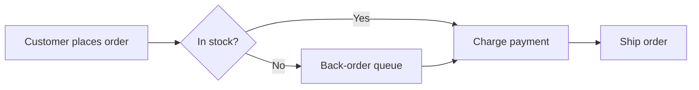
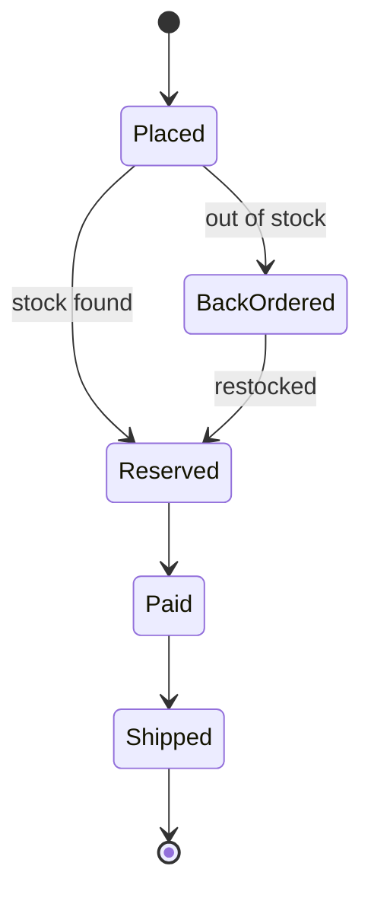
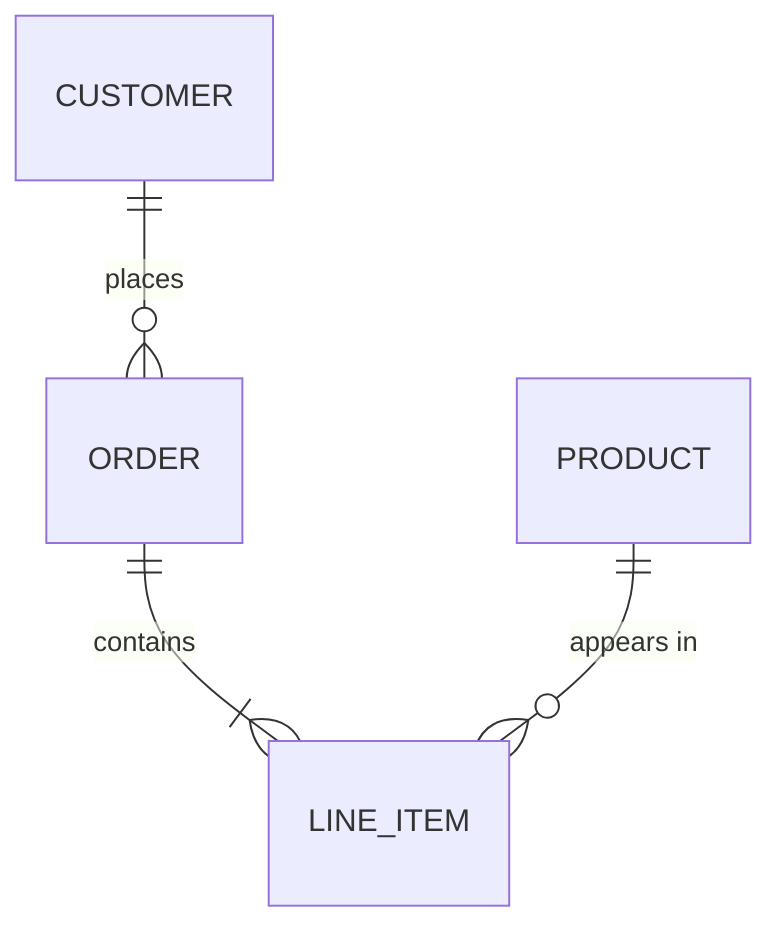

# Order service design

This file is the source of the README screenshots. The text between diagrams is for readers of the document. The slideshow shows only the diagrams.

## How an order moves through the system

Orders enter through the API, pass a stock check, and end up in billing or a back-order queue.

## Who talks to whom

The same diagram can be written in an Azure DevOps block. Both syntaxes become slides in the order they appear in the file.

::: mermaid
sequenceDiagram
    participant Customer
    participant API
    participant Stock
    participant Billing
    Customer->>API: Place order
    API->>Stock: Reserve items
    Stock-->>API: Reserved
    API->>Billing: Charge card
    Billing-->>API: Paid
    API-->>Customer: Order confirmed
:::

## Order states

## Data model

