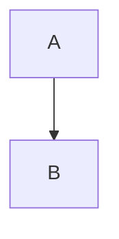

# Mermaid Slideshow: present the diagrams in your Markdown

**Turn the Mermaid diagrams of any Markdown file into a slideshow.** Each diagram gets a full panel to itself, and the arrow keys move between them. The text around the diagrams stays out of the way, and your file is never changed.


- **One diagram per slide:** read, review, or present an architecture document without scrolling past paragraphs.
- **One file for editing and presenting:** the diagrams stay in the Markdown file that holds your notes. There is nothing to export.
- **Live:** the slide updates about 300 ms after you stop typing, and you stay on the slide you were viewing.
- **Matches your editor:** diagrams follow your light or dark VS Code theme, or any Mermaid theme you choose.
- **Almost nothing to set up:** install it, open a Markdown file, and run one command. There is one setting.

## Step through the diagrams

Open a Markdown file that contains Mermaid diagrams. Select the presentation icon in the editor title bar, or run **Mermaid: Show Mermaid Slideshow** from the Command Palette. The slideshow opens beside your editor.

Move with the arrow keys, the mouse wheel, or the ‹ and › buttons. The counter at the bottom right shows where you are, for example "2 / 4". A file with one diagram hides the counter and the buttons. Running the command on another Markdown file reuses the same panel.


## Write diagrams the way you already do

Both common Markdown syntaxes work, and slides follow the order of the blocks in the file.

- **GitHub and CommonMark:** a code fence tagged `mermaid`.
- **Azure DevOps:** a `::: mermaid` block that ends with `:::`.

````markdown


::: mermaid
graph TD
C --> D
:::
````

## Choose a diagram theme

Open Settings and search for "Mermaid Slideshow". The setting `mermaidSlideshow.theme` takes `default`, `dark`, `forest`, or `neutral`.

- **default:** follows your VS Code theme. It uses Mermaid's dark theme for dark and high-contrast editors, and its light theme otherwise.
- **dark:** a dark background with light text.
- **forest:** a green palette.
- **neutral:** grayscale, which suits printing.

A theme change applies to the open slideshow and returns it to the first slide.

| Forest                                                                                                                                                                      | Neutral                                                                                                                                                                      |
| :-------------------------------------------------------------------------------------------------------------------------------------------------------------------------- | :--------------------------------------------------------------------------------------------------------------------------------------------------------------------------- |
|  |  |

## Install

- **VS Code:** open the Extensions view and search for "Mermaid Slideshow", or for the identifier `KunalPathak.mermaid-slideshow`, then select **Install**.
- **Cursor, VSCodium, and other forks:** install `KunalPathak.mermaid-slideshow` from [Open VSX](https://open-vsx.org/extension/KunalPathak/mermaid-slideshow).
- **From a file:** download the `.vsix` from the [GitHub releases](https://github.com/kanad13/mermaid-slideshow-extension/releases) and run **Extensions: Install from VSIX...**.

**Requirements:**

- An editor release at or above the version in the `engines.vscode` field of [package.json](package.json).
- Network access to `cdn.jsdelivr.net`, because the slideshow loads Mermaid from there when it renders.

## What to expect

- A diagram with a syntax error shows "Failed to render diagram N" on its slide, and the other slides keep working.
- If Mermaid cannot load, the panel says so. Check your connection and reopen the slideshow.
- The slideshow shows diagrams only. It does not show the text between them, and it does not export slides.
- A Mermaid block shown inside another code block is sample text, not a slide. Fences of four or more backticks and `~~~` fences are not recognized.
- A file with no diagrams shows a short notice that tells you how to add one.

## Privacy and security

- **No tracking:** the extension collects no telemetry, and your Markdown text stays on your machine. Mermaid renders it locally.
- **One network request:** the panel loads the pinned Mermaid library from `cdn.jsdelivr.net`, so that host sees a normal web request from your IP address. The Content Security Policy permits no other destination, and it allows scripts only from that one package directory.
- **Hostile files:** diagram text is escaped before it enters the page, and Mermaid runs at its default `strict` security level, which sanitizes labels and disables click handlers.
- **No local files:** the panel has no access to files on disk.
- **Restricted Mode:** the extension works in untrusted workspaces, because no setting or file content can run code outside the sandboxed panel.

[architecture.md](docs/architecture.md) describes the security model, and [dependencies.md](docs/dependencies.md) states its limits.

## Contribute

- [development.md](docs/development.md) covers setup, workflow, and release.
- [architecture.md](docs/architecture.md) explains the design.
- [dependencies.md](docs/dependencies.md) holds the dependency policy.
- [testing.md](docs/testing.md) maps workflows to tests.
- [workflows.md](docs/workflows.md) maps each kind of request to its steps and stopping point.
- [sibling-extensions.md](docs/sibling-extensions.md) lists the other extensions published as KunalPathak and the files they share.
- [decisions.md](docs/decisions.md) records ideas that are not built.
- [CHANGELOG.md](CHANGELOG.md) lists the version history.

Start with `npm ci` and `npm test`. Report bugs on the [issue tracker](https://github.com/kanad13/mermaid-slideshow-extension/issues).

Licensed under the [MIT License](LICENSE).
