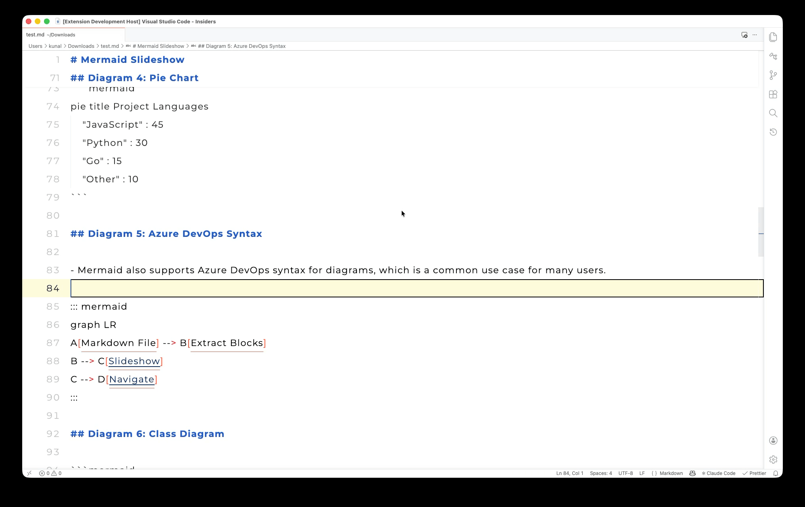

# Mermaid Slideshow

Mermaid Slideshow shows the Mermaid diagrams of a markdown file as a full-panel slideshow in VS Code. Each diagram gets its own slide, without the surrounding text.



VS Code's markdown preview renders diagrams inline between paragraphs. The slideshow pulls them out so that you can read them, review them, or present them.

- **Review:** step through the diagrams of an architecture document without scrolling past text.
- **Present:** move between slides with the arrow keys or the mouse wheel inside the editor.
- **Iterate:** the slideshow updates as you edit the source and keeps your current slide.


## Install

1. Open VS Code or another editor based on it.
2. Open the Extensions view.
3. Search for "Mermaid Slideshow" or `KunalPathak.mermaid-slideshow`, then select **Install**.

**Requirements:**

- An editor release at or above the version in the `engines.vscode` field of [package.json](package.json).
- Network access to `cdn.jsdelivr.net`, because the slideshow loads Mermaid from there when it renders.

## Use

1. Open a markdown file that contains Mermaid blocks.
2. Select the presentation icon in the editor title bar, or run **Mermaid: Show Mermaid Slideshow** from the Command Palette.
3. Move between slides:
    - Press the left, right, up, or down arrow key.
    - Scroll the mouse wheel.
    - Select the `‹` and `›` buttons.

The counter at the bottom right shows your position, for example "2 / 5". A file with one diagram hides the counter and the buttons.

Running the command on another markdown file reuses the same panel.

## Features

**Supported syntax:**

- GitHub and CommonMark fences:

    ````markdown
    ```mermaid
    graph TD
        A --> B
    ```
    ````

- Azure DevOps fenced divs:

    ```markdown
    ::: mermaid
    graph TD
    A --> B
    :::
    ```

- Slides follow the order of the blocks in the file, whichever syntax each block uses.

**Live updates:**

- Edits show up about 300 ms after you stop typing.
- The slideshow keeps your slide number and moves to the last slide when the file has fewer diagrams.

**Themes:**

- Open Settings and search for "Mermaid Slideshow".

| Setting                  | Options                                | Default   | Description                                                   |
| ------------------------ | -------------------------------------- | --------- | ------------------------------------------------------------- |
| `mermaidSlideshow.theme` | `default`, `dark`, `forest`, `neutral` | `default` | Color theme for diagrams. `default` follows the VS Code theme |

- `default` selects Mermaid's dark theme for dark and high-contrast editor themes, and the light theme otherwise.
- `dark` uses a dark background with light text.
- `forest` uses a green palette.
- `neutral` uses grayscale and suits printing.
- A theme change applies to the open slideshow and returns it to the first slide.

**Failure handling:**

- A diagram with a syntax error shows a notice on its slide, and the other slides keep working.
- If Mermaid cannot load, the panel shows a notice.

## Privacy and security

**Data handling:**

- The extension collects no telemetry.
- Your markdown text stays on your machine: Mermaid renders it locally, and the Content Security Policy permits no connection that could carry it out.

**Network access:**

- The webview requests the Mermaid library from `cdn.jsdelivr.net`, so that host sees a normal web request from your IP address.
- The Content Security Policy blocks every other network destination.

**Defenses against hostile files:**

- The page's Content Security Policy (a browser rule that limits what the page may load and run) lets scripts run only with a random one-time token called a nonce, and diagram text is escaped before it enters the page.
- Mermaid runs at its default `strict` security level, which sanitizes labels and disables click handlers.
- The panel has no access to local files.

[architecture.md](docs/architecture.md) describes the security model and [dependencies.md](docs/dependencies.md) states its limits.

## Contribute

- [development.md](docs/development.md) covers setup, workflow, and release.
- [architecture.md](docs/architecture.md) explains the design.
- [dependencies.md](docs/dependencies.md) holds the dependency policy.
- [testing.md](docs/testing.md) maps workflows to tests.
- [decisions.md](docs/decisions.md) records ideas that are not built.
- [CHANGELOG.md](CHANGELOG.md) lists the version history.

Start with `npm ci` and `npm test`. Report bugs on the [issue tracker](https://github.com/kanad13/mermaid-slideshow-extension/issues).
