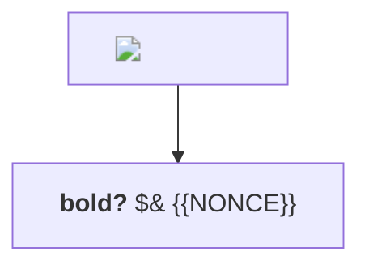
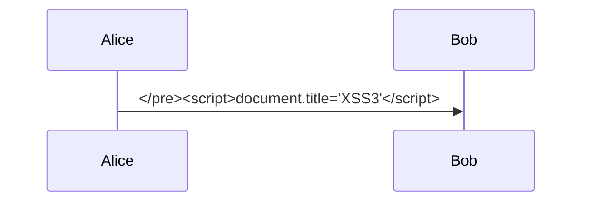

# Hostile and malformed diagrams

Slide 1: HTML in labels (strict security level must show it as text).



Slide 2: syntax error (shows the failure notice, navigation keeps working).

```mermaid
graph TD
    A --> --> B
```

Slide 3: breaking out of the pre element.


